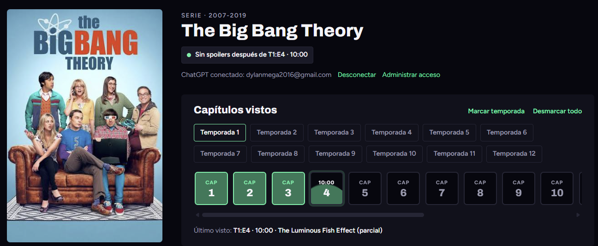
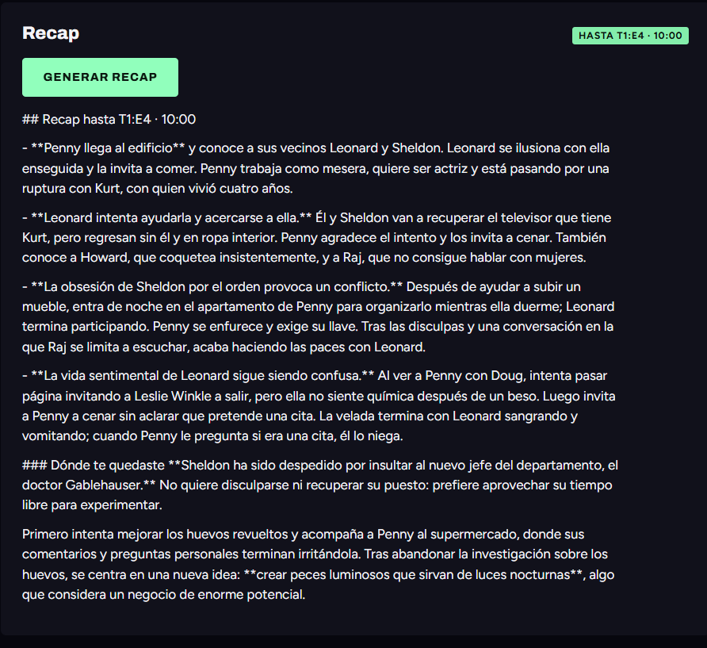
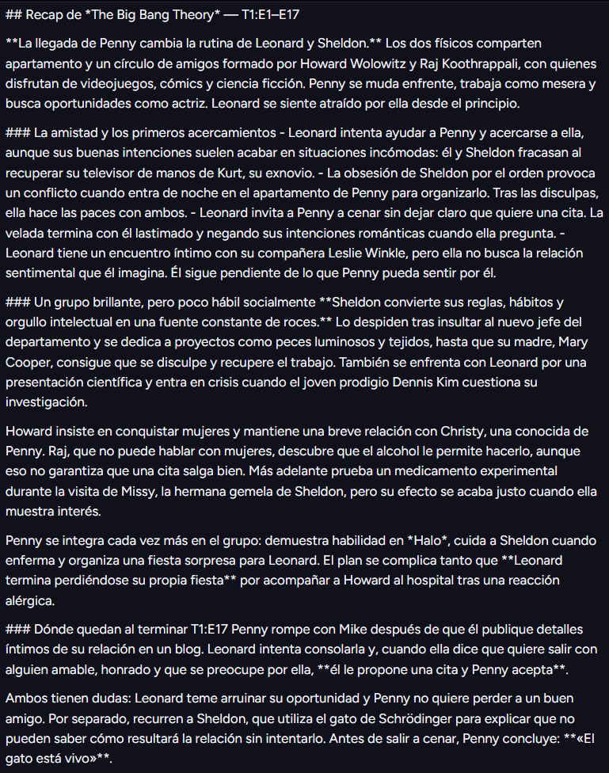
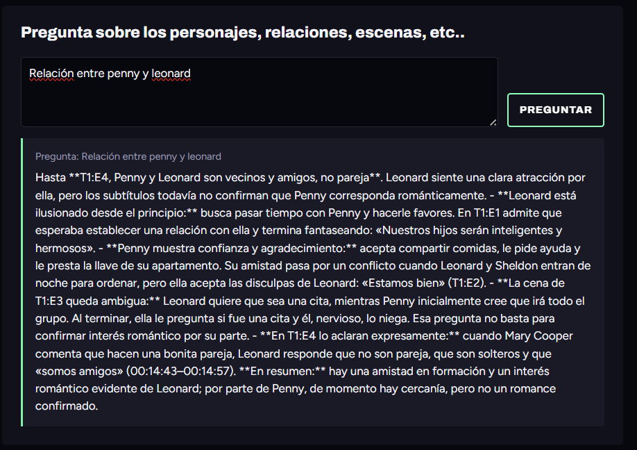
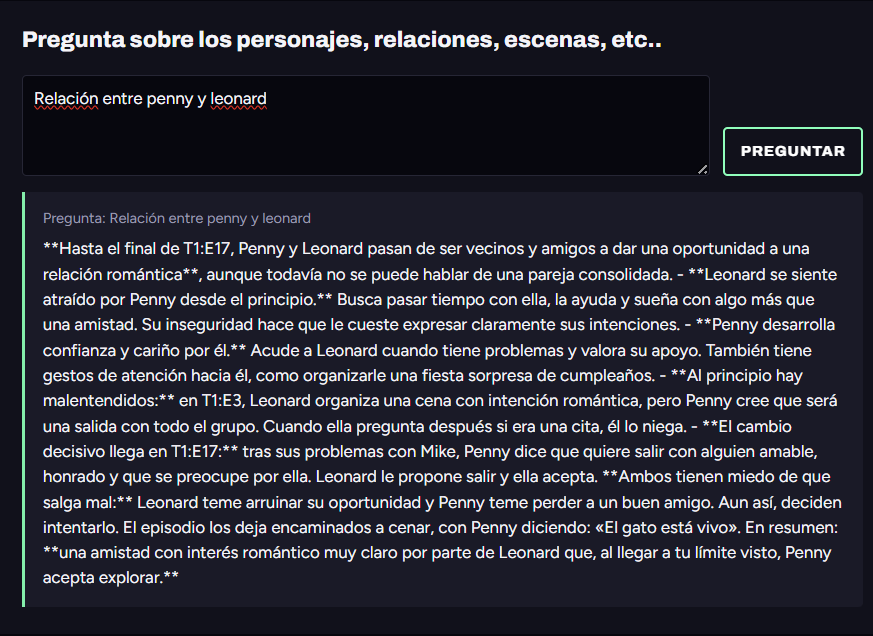
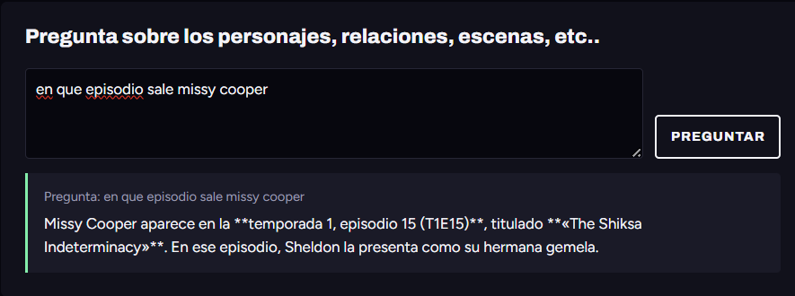
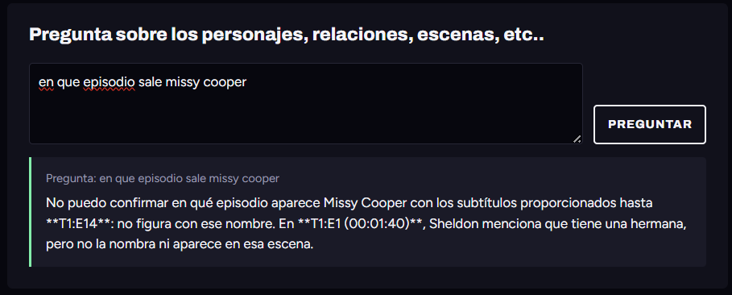

\begin{flushleft}

{\small
\textbf{Universidad de Costa Rica}\\
Escuela de Matemática\\
CA-0204 — Herramientas de Ciencia de Datos I\\
II ciclo, 2026
}

\vspace{0.3cm}

{\Large\textbf{StoryTrack}}\\
\textbf{Avance 3 — Informe de resultados}

\vspace{0.25cm}

{\small
Dylan Madrigal Jiménez \quad María José Angulo Salas\\
Gabriel Guevara Cornejo \quad Harol Arias Sánchez
}

\vspace{0.15cm}

{\small 6 de noviembre de 2026}

\end{flushleft}

\noindent\rule{\linewidth}{0.4pt}

## Introducción

Las series de televisión pueden contar con numerosas temporadas y episodios, lo que dificulta recordar todos los acontecimientos importantes de la historia. Esto ocurre especialmente cuando una persona deja de ver una serie durante un timepo y, al retomarla, no recuerda con claridad lo sucedido en episodios anteriores. 

Ante esta situación surge **Story Track**, un proyecto que busca desarrollar una herramienta que permite a los usuarios llevar un seguimiento de las series que ven, consultar su progreso y acceder a resúmenes de los episodios anteriores. Su finalidad es facilitar que las personas puedan retomar una serie sin necesidad de volver a ver capítulos completos para recordar los acontecimientos más relevantes. 

Para desarrollar el proyecto se utiliza el lenguaje de programación R junto con herramientas de inteligencia artificial. Mediante R, se extrae y organiza la información de los archivos de subtítulos en formato .srt, mientras que la inteligencia artificial se utiliza para analizar y resumir el contenido de los diálogos. Esto permitirá generar resúmenes organizados por episodio, que el usuario podrá consultar según su avance en la serie. 

De esta manera, StoryTrack busca ofrecer una solución práctica para dar seguimiento a las series de televisión, combinando el procesamiento de datos y la inteligencia artificial para facilitar el acceso a información sobre los episodios y sus acontecimientos principales. 

## Objetivo general

Desarrollar una herramienta que facilite el segumiento de series de televisión, permitiendo al usuario consultar su progreso y recordar los acontecimientos más importantes de la historia mediante resúmenes generados con inteligencia artificial. 

## Metodología

# Obtención y procesamiento de los subtítulos

Para el desarrollo de StoryTrack se utilizaron únicamente los subtítulos de la serie *The Big Bang Theory*, con el propósito de trabajar con una base de datos más sencilla y delimitar el alcance del proyecto. Esto permitió concentrarse en las funciones principales de la herramienta. Los archivos utilizados se encuentran en formato .srt, el cual contiene  los diálogos de los episodios junto con sus respectivos tiempos de aparición. 

El procesamiento se realizó mediante el lenguaje de programación R. Para ello, se creó la función leer.subtitulos (), encargada de leer los archivos, identificar los bloques de subtítulos y extraer la información necesaria para construir una base de datos estructurada.

A partir de los bloques de subtítulos se extrajeron nueve variables: nombre de la serie, temporada, episodio, número de bloque, tiempo de inicio, tiempo de finalización, personaje, texto y nombre del archivo original. La variable personaje se incorporó posteriormente para identificar a quién corresponde cada diálogo, cuando esta información se encuentra disponible en los subtítulos. 

# Filtrado de la historia 

Posteriormente, se desarrolló la función filtrar.historia(), con el propósito de limitar la información disponible según el progreso del usuario en la serie y evitar que se revelen acontecimientos que todavía no ha visto. 

Esta función recibe la base de datos de subtítulos y la información correspondiente a la serie, temporada y tiempo seleccionado por el usuario. Para realizar el filtrado, los tiempos de los subtítulos se convierten a segundos, lo que permite compararlos con el límite establecido. 

De esta manera, se conservan los subtítulos de las temporadas y episodios anteriores al punto seleccionado, así como aquellos del episodio actual cuyo tiempo de finalización no supera el minuto indicado. Este procedimiento constituye la base del sistema denominado **Spoiler Guard**, encargado de restringir la información utilizada posterioremente por la inteligencia artificial. 

# Creación del contexto

Una vez filtrada la información, se desarrolló la función crear.contexto(), encargada de organizar los subtítulos seleccionados en un formato de texto que pueda utilizarse como entrada para la inteligencia artificial. 

Para ello, se combinan los datos de cada regsitro, incluyendo la temporada, el episodio, los tiempos de inicio y finalización, el personaje identificado y el diálogo correspondiente. 

Posteriormente, los registros se unen en un único texto, se unen en un único texto, conservando la información necesaria para identificar a qué episodio y momento pertenece cada intervención. Así, se construye el contexto que se enviará a la inteligencia artificial, utilizando únicamente los subtítulos permitidos por el filtrado anterior. 

# Desarrollo de la aplicación en Shiny 

Para integrar las funciones anteriores, se desarrolló una aplicacion interactiva mediante la libreria shiny de R, cuya estructura principal se encuentra en el archivo app.R.

Dentro de este archivo se incorporó la lectura y consolidación de los subtítulos procesados, así como un catálogo de series y una interfaz que permite seleccionar temporadas y episodios. Aunque el catálogo incluye otras series como ejemplos, el procesamiento de subtítulos se desarrolló utilizando *The Big Bang Theory*. La aplicación permite al usuario registrar su progreso.

Se integraron las funciones filtrar.historia () y crear.contexto(), de manera que la información utilizada para generar resúmenes o responder presguntas se ajuste al progreso registrado por el usuario. La interfaz también incorpora las opciones para solicitar resúmenes y realizar preguntas relacionadas con los personajes y acontecimientos de la serie. 

# Integración con ChatGPT

Finalmente, se desarrolló el archivo chatgpt_local.R, encargado de gestionar la conexión entre StoryTrack y ChatGPT. Este código implementa un procedimiento de autenticación para que el usuario pueda autorizar el acceso desde la aplicación. 

Una vez establecida la conexión, la aplicación está programada para enviar a ChatGPT el contexto previamente filtrado, junto con instrucciones específicas para generar resúmenes o responder preguntas sobre la serie.

Las instrucciones establecen que las respuestas deben elaborarse utilizando únicamente la información proporcionada en los subtítulos, sin incorporar acontecimientos posteriores al progreso del usuario. Asimismo, se indica que, cuando la información disponible no permita responder una pregunta, debe señalarse esta limitación.

De esta forma, se busca combinar el seguimiento de episodios con la generación de resúmenes y respuestas mediante inteligencia artificial, utilizando SpoilerGuard para limitar el contenido enviado según el avance del usuario.

# Resultados 

## Selección de capitulos y temporadas en Shiny
{#fig-progreso width=85%}

Aquí el resultado es que la interfaz permite definir con precisión hasta dónde llegó el usuario.

## Generación del recap sin spoilers hasta el episodio 4, minuto 10

{#fig-recap width=90% fig-pos="H"}

## Generación del recap sin spoilers hasta el episodio 17 (Toda la primera temporada)

{#fig-recap width=90% fig-pos="H"}

Se puede notar que a la hora de agregar más episodios vistos, el resumen cambia completamente por la información nueva añadida.

## Respuesta sobre la relación de dos personajes hasta el episodio 4

{#fig-recap width=90% fig-pos="H"}

Acá podemos ver como evoluciona la relación entre los personajes Penny y Leonard pero solo hasta el capitulo 4, viendo que en efecto la IA no cuenta la historia sobre ellos después de este capitulo.

## Respuesta sobre la relación de dos personajes hasta el episodio 17 (Toda la primera temporada)

{#fig-recap width=90% fig-pos="H"}

Podemos ver que cuando se marca toda la primera temporada, en efecto la historia entre ellos avanza ya que la IA tiene más acceso a nueva información.

## Buscar escenas hasta el E17

{#fig-recap width=90% fig-pos="H"}

Con el resultado anterior, podemos ver que, cuando marcamos la temporada 1 completa, logra encontrar satisfactoriamente al personaje Missy Cooper, especificando el episodio.

## Buscar escenas hasta el 14

{#fig-recap width=90% fig-pos="H"}

Note que a diferencia del resultado anterior, como se marcaron hasta el episodio 14, quitando el episodio 15 que es donde sale Missy, la app no nos proporciona la información, probando que en efecto el filtrador de información funciona.
# Bibliografía

OpenSubtitles. (s. f.). OpenSubtitles: Subtitles search. Recuperado el 6 de noviembre de 2026, de https://www.opensubtitles.org/en/search/subs

OpenAI. (2026). ChatGPT [Modelo de lenguaje de gran escala]. https://chatgpt.com/

# Anexos

https://github.com/dylanmega2016-design/StoryTrack.git

